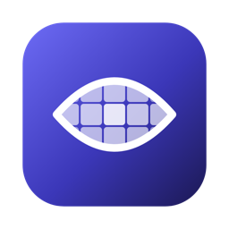

# Sitr

[العربية](README.ar.md)

Sitr is a macOS menu bar app that hides people on your screen as they appear — women, men, or everyone — in every
app: browsers, chat apps, photo libraries, video players, video calls. It captures the screen with ScreenCaptureKit,
finds people with Core ML on the Neural Engine, classifies each one as Woman, Man, or Unknown, and covers the whole
body of everyone in the category you chose with a blur, pixelation, or a solid block.

Everything runs on your Mac. Sitr is sandboxed and ships without a network entitlement, so it cannot open a network
socket: no pixels, logs, telemetry, or crash reports leave the machine. Frames stay in memory and are never written
to disk. You can check this yourself, see [Verify the privacy claim](#verify-the-privacy-claim).

Sitr can also remove music from videos in your browser (optional, off by default, see
[Music removal in the browser](#music-removal-in-the-browser)). That feature runs in a separate helper app with its own
sandbox and network access; Sitr itself keeps its no-network entitlement and never sends screen frames to the helper.

## Requirements

- macOS 15 or later.
- A Mac with Apple silicon (M1 or newer). Intel Macs are not supported.
- The Screen & System Audio Recording permission for screen protection (video only; Sitr never records audio).

## Install

**DMG.** Download `Sitr-<version>.dmg` from [GitHub Releases](https://github.com/haithamassoli/Sitr/releases), open
it, drag `Sitr` to `Applications`, and launch it. Release builds are Developer ID signed and notarized. The
`checksums.txt` file next to the DMG carries its SHA-256; `shasum -a 256 Sitr-<version>.dmg` must print the same line.

**Homebrew** (available after the first release):

```sh
brew install --cask haithamassoli/sitr/sitr
```

## First run

Sitr has no Dock icon; look for the eye-slash icon in the menu bar. The first launch opens a short setup window that
starts with one question: what should Sitr do? Pick **Hide people on screen**, **Remove music from videos**, or both.
The steps after that depend on the answer:

- **Hide people:** choose Women, Men, or Everyone (*Blur Unknown (Strict Mode)* is on by default and also covers people
  Sitr cannot classify; Everyone always includes them), then allow **Screen Recording**: click *Allow Screen
  Recording* and approve the macOS dialog, or open System Settings › Privacy & Security › Screen & System Audio
  Recording and turn Sitr on. Setup continues on its own once the permission is granted. Your browsers and chat apps
  (the recommended preset below) are protected; change the list any time in Settings › Hide People.
- **Remove music:** install the browser extension (see [Music removal in the browser](#music-removal-in-the-browser)).
  Sitr never asks for Screen Recording when you only want music removal.

The last page sums up what is on and offers *Launch at login*.

### Monthly re-approval

Starting with macOS 15.1, macOS asks you to re-approve screen recording for every app roughly once a month. When the
grant lapses, Sitr's menu bar icon gets a warning badge, the status line reads *Needs Screen Recording permission*,
one notification is posted, and the permission step of the setup window comes back. Until capture resumes, apps in
Curtain mode are covered with a solid block over each window; apps in Blur mode are uncovered.

## How protection works

Every app runs in one of three modes:

| Mode | What happens |
|---|---|
| **Off** | The app is never captured or analyzed. |
| **Blur** | Frames are captured and analyzed; people in the hidden set are covered as soon as they are detected, roughly 100–200 ms after they appear. |
| **Curtain** | Changed regions of the app's windows are covered the moment they change, then uncovered once detection has verified them safe. Exposure is bounded by capture-to-draw latency, not zero. Scrolling with a mouse or trackpad is not covered: people on the page are covered once detected. A region that keeps changing for half a second (a video) behaves like Blur until it is static again. |

The **Default Rule** is the mode for every app without an override. Its initial value is Off, so a fresh install
covers nothing until you add rules; setting it to Blur or Curtain protects the entire Mac. In Settings › Hide People ›
*Where to hide* it is the *All other apps* row; the rows above it assign a mode per app: *Add App* picks a running app,
or any `.app` file.

**Recommended preset**, applied when you choose to hide people during setup and available in Settings › Hide People ›
*Add browsers and chat apps* (the Default Rule stays Off):

| Group | Apps | Mode |
|---|---|---|
| Browsers | Safari, Chrome, Arc | Curtain |
| Communication | Telegram, WhatsApp, Discord | Curtain |

**Categories.** Each detected person is Woman, Man, or Unknown. Unknown means facing away, face hidden or too small,
too far, or classifier confidence below 80 %. The hidden set is Women, Men, or Everyone. *Blur Unknown (Strict Mode)*
adds Unknown to the hidden set; it is forced on for Everyone.

**Covers.** The full body box, expanded by *Body Padding* (default 15 %), is covered with the style chosen in
Settings › General › Covers: Gaussian blur (default, strength 70 %), Pixelate, or Solid. A cover appears on the first
detected frame and lingers briefly after the person leaves, so it does not flicker.

**Reveal Hold.** Hold ⌃⌥Space to see what is under the covers on every display; release to cover again. As a safety
net the covers come back after 30 seconds of holding, or when the modifier keys are released without a matching
key-up event. Reveal is unavailable while protection is paused or disabled, or while the permission is missing.
Change the shortcut in Settings › General › Reveal Hold; ⌥Space is refused because Siri and the ChatGPT app use it.

**Menu bar.** Clicking the icon opens a small panel with one card per feature, each with its own switch. The *Hide
people* card shows the status (Protected, Paused until a time, Needs Screen Recording permission, Degraded, …), a
Women / Men / Everyone switcher, and *Pause* for 15 minutes or 1 hour, which removes all covers and resumes on its own.
Turning the switch off stays off until you turn it on again; turning it on with no apps configured adds the recommended
browsers and chat apps. The *Remove music* card turns the music helper on or off and links to the extension setup. The
icon is dimmed while paused or off and carries a warning badge when the permission is missing or detection is running
slowly. With no app set to Blur or Curtain (music removal only), a missing Screen Recording grant is not a warning.

Settings and the menu also show preparation, configured-app scope, capture recovery, and limited detection. A stopped stream with a valid permission gets a retry action; a missing grant opens Screen Recording settings. Pausing or disabling stops capture and inference, then resumes from a fresh frame.

If saving rules fails, Settings keeps a retry message visible. Unreadable rules remain untouched until you retry reading or explicitly reset them; reset keeps a recovery copy. Settings › General › Covers has a separate reset that preserves protection rules.

## Music removal in the browser

Sitr can play web videos with the music removed and the speech kept, in Google Chrome, Microsoft Edge, Brave, or Arc.

1. Turn on **Remove music** in the menu bar panel (or Settings › **Remove Music**). The first time, Sitr downloads a voice model
   (about 80 MB, once).
2. Install the browser extension by following the four steps on that page: open the extensions page, turn on
   Developer mode, and drag in the extension folder that Sitr shows you. A checkmark appears once the extension
   connects. (A one-click Chrome Web Store version is on its way.)
3. On a video, press **Remove music**. Press it again for the original sound.

The helper downloads the audio of the video you chose from its website and separates the voice on your Mac. The
first audio plays about 3 seconds after you press the button, and a 20-minute video is fully processed in about 2
minutes on an M3. Singing can remain, because the model keeps human voices. Live streams and protected videos may not
work. Keep Sitr in the Applications folder, since the browser loads the extension from there.

## Verify the privacy claim

Run this in Terminal (Settings › About shows the same command with a Copy button):

```sh
codesign -d --entitlements :- --xml /Applications/Sitr.app
```

Expected output (append `| plutil -convert xml1 -o - -` to the command for this indented form):

```xml
<?xml version="1.0" encoding="UTF-8"?>
<!DOCTYPE plist PUBLIC "-//Apple//DTD PLIST 1.0//EN" "http://www.apple.com/DTDs/PropertyList-1.0.dtd">
<plist version="1.0">
<dict>
	<key>com.apple.security.app-sandbox</key>
	<true/>
	<key>com.apple.security.files.user-selected.read-only</key>
	<true/>
</dict>
</plist>
```

`com.apple.security.app-sandbox` is `true`, and there is no `com.apple.security.network.client` or
`com.apple.security.network.server` key: the sandbox refuses every socket the process could try to open. The second
entitlement only lets Sitr read the bundle identifier of an `.app` you pick in the Add App dialog of Settings › Hide People.
CI runs the same check on every build (`scripts/check-entitlements.sh`).

## Screen sharing and screenshots

- **Sharing your entire screen** (Zoom, FaceTime, Meet, …): the overlay is a normal window above everything else, so
  viewers usually see the covers.
- **Sharing a single window:** the overlay is not part of that window, so covers are not guaranteed to reach the
  viewers.
- **Screenshots and screen recordings** include the covers.

Sitr does not try to hide its covers from screen sharing or screenshots: a person who is covered on your screen is
covered in the capture as well.

## Performance

Capture normally runs at 15 frames per second, rising to 30 on displays with Curtain windows (capped at 8 in Low Power Mode when the Settings › General toggle is on), only on
the displays and apps that need it, and skips frames in which nothing changed. The targets for an M1 with 8 GB are: person visible to covered in at most 150 ms (95th percentile) in Blur mode and 60 ms
in Curtain mode at 30 fps capture; Reveal press or release within one frame; under 1 % CPU on a static screen, about 15 % of one
performance core while browsing, about 25 % during 1080p video with people; under 300 MB of memory. Performance depends on the workload. These are targets; see [current validation](docs/perf.md) for measurements and remaining gaps. A saturated GPU (games, video export) can delay covers, which the menu bar reports as Degraded.

## Build from source

Requirements: Xcode 26 (Swift 6, macOS 15 SDK) on Apple silicon. There is no Xcode project; Sitr is a Swift package.

```sh
git clone https://github.com/haithamassoli/Sitr.git && cd Sitr
swift build                                    # every target
swift test                                     # unit tests: policy, tracker, curtain, settings, onboarding, localization, model checksums
scripts/build-app.sh                           # assembles build/Sitr.app: Info.plist, Core ML models, String Catalog, ad-hoc signature
scripts/check-entitlements.sh build/Sitr.app   # sandbox on, no network entitlement
scripts/check-strings.sh                       # every UI string is in the String Catalog with an Arabic translation
```

`build/Sitr.app` is signed ad hoc, so macOS treats it as an app you built yourself; launch it from Finder or run
`build/Sitr.app/Contents/MacOS/Sitr` from a terminal. Release builds come from `scripts/release.sh` and
`scripts/make-dmg.sh`, see `docs/m5/release.md`.

The two Core ML models are committed under `Models/dist/`: no download step, no build-time network access.
`Models/dist/CHECKSUMS.txt` and `Models/dist/CHECKSUMS-PersonDetector.txt` list the SHA-256 of every file inside the
packages, and the `ModelChecksumTests` test fails when anything differs. By hand:
`cd Models/dist && shasum -a 256 -c CHECKSUMS.txt CHECKSUMS-PersonDetector.txt`.

## Models and licenses

| Model | Origin | License |
|---|---|---|
| Person detector, `PersonDetector.mlpackage` | YOLOX-M by Megvii Inc., converted to Core ML without retraining | Apache-2.0 |
| Gender classifier, `GenderClassifier.mlpackage` | `dima806/fairface_gender_image_detection` (ViT-B/16), converted to Core ML without retraining; trained on FairFace | Apache-2.0; FairFace is CC BY 4.0 |

Provenance, conversion commands, and the full license texts: [`THIRD_PARTY_NOTICES.md`](THIRD_PARTY_NOTICES.md),
`Models/dist/SOURCE.md`, `Models/dist/SOURCE-PersonDetector.md`. Sitr has no Swift package dependencies.

## Languages

English and Arabic, with a right-to-left layout for Arabic. Sitr follows the system language order; Settings ›
General › Language overrides it for Sitr alone, and the change applies after a relaunch.

## Uninstall

1. Quit Sitr from the menu bar (*Quit Sitr*).
2. Delete `/Applications/Sitr.app`.
3. Delete `~/Library/Containers/com.goldentik.Sitr`, the sandbox container that holds your settings and the rules file.
4. If *Launch at login* was on, remove Sitr from System Settings › General › Login Items & Extensions (deleting the
   app usually removes the entry on its own).

With Homebrew, `brew uninstall --zap --cask sitr` removes the app and the container.

## License

GPL-3.0-only, see [`LICENSE`](LICENSE). Security reports: [`SECURITY.md`](SECURITY.md). Contributions:
[`CONTRIBUTING.md`](CONTRIBUTING.md).
